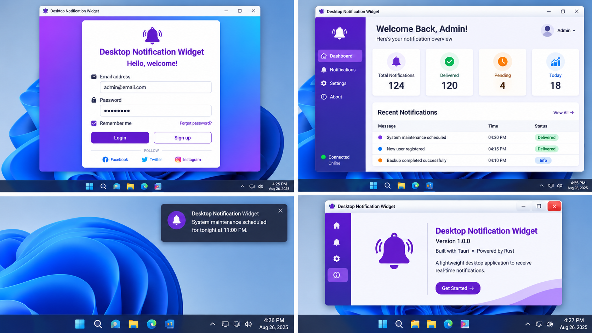

# 🔔 Desktop Notification Widget

**A lightweight Windows desktop app that brings live stock and production updates from the server to every desk on the plant network, for the automobile industry.**

Built with Tauri (Rust), the widget sits on users' desktops, signs in to the central server and shows real-time notifications: stock levels, production figures, shift updates and alerts. A dashboard summarises what has been delivered, what is pending and what came in today, and a floating pop-up shows each new notification as it arrives.

> ℹ️ This is a showcase repository. The source code is private; this page describes the purpose, features and tech used. Screenshots show sample data.

---

## 📸 Screenshots

Login, notification dashboard, floating desktop notification and the About screen.

---

## 🏭 Use case

In an automobile manufacturing setup, stores, production, quality and management teams work on different systems across the plant network. The widget pushes the information each team needs straight to their desktop:

- **Stock updates:** inward and outward stock movements, low-stock alerts
- **Production data:** shift-wise production counts and targets
- **Plant alerts:** maintenance schedules, system notices and urgent messages

## ✨ Features

| Area | What it does |
|---|---|
| **Login** | Sign-in screen with remember-me and password recovery |
| **Dashboard** | Totals for all, delivered, pending and today's notifications, plus recent notifications with status |
| **Floating notifications** | Pop-up on the desktop for every new message, even when the app is minimised |
| **Notifications** | Full notification history |
| **Settings** | User preferences and connection settings |
| **Connection status** | Live online/offline indicator for the server connection |
| **Native window** | Windows-style minimise, maximise and close controls |
| **Lightweight** | Small Tauri executable with low memory use, packaged as a Windows installer |

## 🛠️ Tech Stack

| Technology | Purpose |
|---|---|
| Tauri | Desktop application framework |
| Rust | Native backend |
| HTML5, CSS3 / Tailwind CSS | User interface |
| JavaScript | Application logic |
| WebSocket | Real-time server-to-desktop delivery (in progress) |

## 🗺️ Roadmap

- WebSocket-based real-time delivery from the server
- Secure server-side authentication
- Start automatically with Windows
- User- and department-specific notifications
- Automatic application updates

## 👤 My role

Designed and built the desktop application: UI, dashboard, floating notifications, Tauri packaging for Windows and the server notification flow.

---

📫 Want to know more? See my [portfolio](https://varunvasudevan.github.io).
